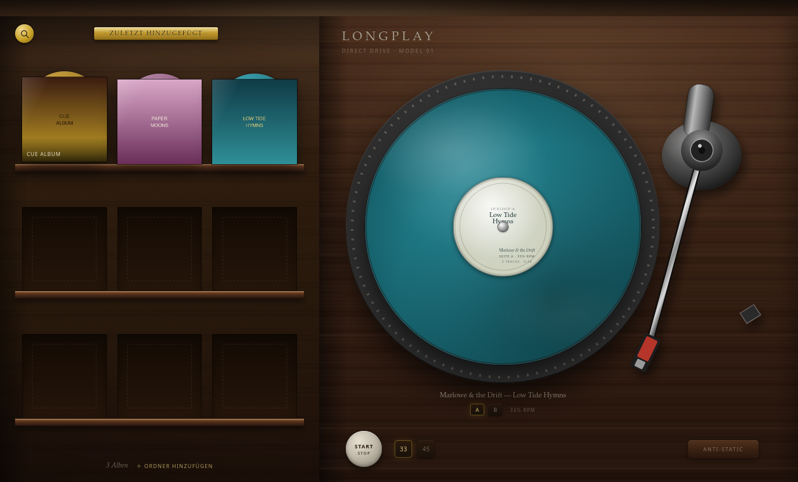

# Longplay

Ein skeuomorpher Plattenspieler für die eigene Musiksammlung — für macOS, gebaut mit
Rust und Tauri.

Deine Alben liegen als Dateien auf dem Rechner. Longplay zeigt sie als Schallplatten in
einer Holzkiste, legt sie auf einen Direct-Drive-Plattenspieler und lässt dich den Tonarm
von Hand aufsetzen, am Teller scratchen, zwischen 33⅓ und 45 umschalten und Alben wie
echte LPs in Seite A und B teilen — inklusive Knistern, Rumpeln und subtiler Nadelphysik.

> **Status:** Phase 1 — Bibliothek. Ordner scannen, Alben mit Covern und Farbpalette
> in der Kiste, Seite A/B, Auswahl landet auf dem Teller. Audio folgt in Phase 2.



## Prinzipien

- Lokale Dateien, keine Accounts, kein Netzwerk, keine Telemetrie.
- Der Rust-Kern macht die Arbeit: Bibliothek, Audio, Tonarm-Logik, Persistenz.
- Die Oberfläche ist eine dünne Schicht (Svelte 5 im WKWebView).
- Deutsche UI, native Mac-Details (Titlebar, Menübar, Media-Keys).

## Entwicklung

Voraussetzungen: Rust (stable), Node 22+, auf macOS Xcode Command Line Tools.

```bash
npm install
npm run tauri dev
```

Zum schnellen UI-Test ohne Ordnerdialog scannt `LONGPLAY_SCAN_DIR` beim Start:

```bash
LONGPLAY_SCAN_DIR=/pfad/zur/musik npm run tauri dev
```

Auf Linux zusätzlich:

```bash
sudo apt install libwebkit2gtk-4.1-dev libgtk-3-dev librsvg2-dev \
  libayatana-appindicator3-dev
# erst ab Phase 2 (Audio-Ausgabe):
sudo apt install libasound2-dev
```

Prüfen:

```bash
npm run check
npm run build
cargo test --manifest-path src-tauri/Cargo.toml
```

Release bauen (macOS):

```bash
npm run tauri build
```

## Struktur

```
src/                 Svelte-Oberfläche (Crate, Deck, später Gatefold)
src-tauri/src/
  audio/             Dekoder, Ringpuffer, Resampler, Vinyl-Geräusche
  library/           Scan, Tags, CUE, Cover, Palette, SQLite
  playback/          Timeline, Queue, Tonarm, Zustandsmaschine
  platform/          Menübar, Now Playing, Media-Keys
PLAN.md              Architektur, Datenmodell, Phasen, Abnahmekriterien
```

Der vollständige Plan steht in [PLAN.md](PLAN.md).

## Lizenz

MIT — siehe [LICENSE](LICENSE).
