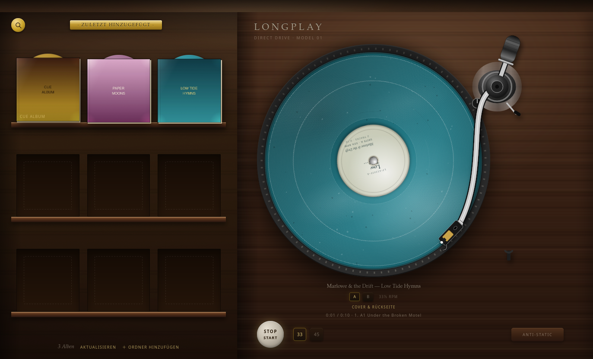

# Longplay

Ein skeuomorpher Plattenspieler für die eigene Musiksammlung — für macOS, gebaut mit
Rust und Tauri.

Deine Alben liegen als Dateien auf dem Rechner oder NAS. Longplay zeigt sie als
Schallplatten in einer Holzkiste, legt sie auf einen Direct-Drive-Plattenspieler und
lässt dich den Tonarm von Hand aufsetzen, zwischen 33⅓ und 45 umschalten und Alben wie
echte LPs in Seite A und B teilen — inklusive Knistern, Rumpeln und subtiler Nadelphysik.

> **Status:** Phase 3 — Interaktion. Der Tonarm folgt der Rille, lässt sich zum Cueen
> ziehen, kehrt am Seitenende zurück; die Platte dreht mit Anlauf und Auslauf, Singles
> sind kleiner, Seite A/B flip. Material- und Lichtpolitur folgt.



**Audio:** Es wird immer nur der aktuelle Song dekodiert (48 kHz stereo, inklusive
Pregap); der nächste lädt im Hintergrund vor. Das ist für Bibliotheken auf einem NAS
gedacht und hält den Speicher klein. Wiedergabe läuft über einen Catmull-Rom-Resampler
mit Varispeed; Knistern, Rumpeln, Nadel-Fall, Wow/Flutter und Innenrillen-Charakter
werden prozedural erzeugt.
Auf macOS geht es über CoreAudio (cpal) mit dem **Standard-Ausgabegerät**; Stereo liegt
auf den ersten beiden Kanälen, weitere Ausgänge eines Interfaces bleiben still. Es gibt
bewusst keinen Geräte-Picker: was macOS als Standardausgabe führt, wird benutzt.

Die Rillen sind kein Dekor: Ein Layout teilt die Spielfläche nach echten Plattenmaßen
(12″: Musik 146→60 mm bei 5 mm Lead-in; 7″: 84→45 mm) in Track-Bänder, Land und
Auslaufrille. Dasselbe Layout führt den Tonarm.
Auf Linux läuft zum Entwickeln ein Echtzeit-Null-Sink, weil hier die ALSA-Header fehlen.

## Prinzipien

- Lokale Dateien, keine Accounts, kein Netzwerk, keine Telemetrie.
- Der Rust-Kern macht die Arbeit: Bibliothek, Audio, Tonarm-Logik, Persistenz.
- Die Oberfläche ist eine dünne Schicht (Svelte 5 im WKWebView).
- Deutsche UI, native Mac-Details (Titlebar, Menübar, Media-Keys).

## Entwicklung

Voraussetzungen: Rust (stable), Node 22+, auf macOS Xcode Command Line Tools.

```bash
npm install
npm run tauri dev
```

Bedienung: Album anklicken (oder `1`–`9` für die Alben der aktuellen Seite) legt es auf,
`START/STOP` bzw. `Leertaste` startet, die Tabs `A`/`B` wechseln die Seite, `33`/`45`
ändern die Drehzahl (und damit Tonhöhe und Tempo).
Auf die Platte ziehen setzt die Nadel an der Stelle ab; beim Überfahren zeigt ein
kleines Etikett den Track unter dem Zeiger. Beim Cueen in einen anderen Track bleibt
die Nadel sichtbar auf der Platte, während der Track nachlädt; der vorgeladene nächste
Track springt sofort. `Leertaste` startet und stoppt.

**Hülle:** „Cover & Rückseite“ am Plattenspieler (oder `G`) öffnet das Cover groß;
Klick auf die Hülle oder `Leertaste` dreht sie um und zeigt die generierte Rückseite
mit Tracklist, Seiten- und Gesamtlaufzeit, Katalog und Barcode. `Esc` schließt.

**Material:** Papierkanten und Ringwear an den Hüllen, Abrieb und Pressring am Label,
Staub und feine Kratzer auf der Platte, ein wandernder Warp-Glanz und ein warmer
Lichtkegel über der Kiste. Alles prozedural, keine zusätzlichen Bilddateien.

Zum schnellen UI-Test ohne Ordnerdialog scannt `LONGPLAY_SCAN_DIR` beim Start:

```bash
LONGPLAY_SCAN_DIR=/pfad/zur/musik npm run tauri dev
```

Auf Linux zusätzlich:

```bash
sudo apt install libwebkit2gtk-4.1-dev libgtk-3-dev librsvg2-dev \
  libayatana-appindicator3-dev
# erst ab Phase 2 (Audio-Ausgabe):
sudo apt install libasound2-dev
```

Prüfen:

```bash
npm run check
npm run build
cargo test --manifest-path src-tauri/Cargo.toml
```

Release bauen (macOS):

```bash
npm run tauri build
```

## Struktur

```
src/                 Svelte-Oberfläche (Crate, Deck, später Gatefold)
src-tauri/src/
  audio/             Dekoder, Ringpuffer, Resampler, Vinyl-Geräusche
  library/           Scan, Tags, CUE, Cover, Palette, SQLite
  playback/          Timeline, Queue, Tonarm, Zustandsmaschine
  platform/          Menübar, Now Playing, Media-Keys
PLAN.md              Architektur, Datenmodell, Phasen, Abnahmekriterien
```

Der vollständige Plan steht in [PLAN.md](PLAN.md).

## Lizenz

MIT — siehe [LICENSE](LICENSE).
